# 基于微信小程序的付费自习室管理系统

> 🎓 **计算机毕业设计 · 基于微信小程序的付费自习室管理系统**
>
> 本仓库只放**项目介绍 + 运行截图**（截图是站点带水印的原图，存在仓库 `images/` 里）。
>
> 👉 **完整可运行源码 / 数据库脚本 / 部署文档：[点我获取](https://geekcode.top/archives/%E5%9F%BA%E4%BA%8E%E5%BE%AE%E4%BF%A1%E5%B0%8F%E7%A8%8B%E5%BA%8F%E7%9A%84%E4%BB%98%E8%B4%B9%E8%87%AA%E4%B9%A0%E5%AE%A4%E7%AE%A1%E7%90%86%E7%B3%BB%E7%BB%9F?utm_source=github)**
>
> 💬 咨询微信：**ir9372**　|　🌐 更多项目：[极客代码 geekcode.top](https://geekcode.top/?utm_source=github)
>
> 📌 项目详情页：<https://geekcode.top/archives/%E5%9F%BA%E4%BA%8E%E5%BE%AE%E4%BF%A1%E5%B0%8F%E7%A8%8B%E5%BA%8F%E7%9A%84%E4%BB%98%E8%B4%B9%E8%87%AA%E4%B9%A0%E5%AE%A4%E7%AE%A1%E7%90%86%E7%B3%BB%E7%BB%9F?utm_source=github>

<table><td width="230" align="center"> <b>扫码加微信 ir9372</b></td><td valign="middle">📦 源码 = 项目介绍 + 全部运行截图 + 数据库 + 部署文档 👉 点上方任意截图，直接跳到 <b>极客代码 geekcode.top</b> 详情页</td></table>

---

<h1>基于微信小程序的付费自习室管理系统</h1>
<h2>项目概述</h2>

本项目旨在构建一个基于微信小程序的付费自习室管理系统，解决传统自习室资源分配不均、预约流程繁琐及用户管理数字化程度低的问题。系统采用前后端分离架构，后端基于 Spring Boot 框架结合 MyBatis-Plus 实现高效数据交互，前端涵盖微信小程序端与 Vue 后台管理端。核心功能包括自习室在线浏览与预约、订单全流程管理、新闻资讯发布、用户个人中心维护及商家管理。适用人群主要为需要固定学习场所的学生、考研党及自由职业者，以及提供自习空间服务的运营商家。通过该系统，实现了从用户注册登录、自习室筛选、下单支付到评价反馈的闭环服务，提升了自习室资源的利用效率与管理便捷性。

<h2>技术架构</h2>

本系统采用典型的分层架构设计，确保系统的可维护性与扩展性。

<h3>后端架构</h3>

后端基于 Java 语言开发，使用 Spring Boot 作为核心框架，集成以下关键组件：

<ul>
<li><strong>Web 层</strong>：使用 <code>spring-web</code> 和 <code>spring-webmvc</code> 处理 HTTP 请求与响应，提供 RESTful API 接口供小程序和后台调用。</li>
<li><strong>业务逻辑层</strong>：利用 <code>spring-context</code> 进行依赖注入与管理，通过 <code>spring-tx</code> 保证事务一致性。</li>
<li><strong>数据访问层</strong>：采用 <code>MyBatis-Plus</code> 简化 CRUD 操作，底层数据库连接池使用 <code>Druid</code>，以增强性能监控与安全控制。</li>
<li><strong>其他模块</strong>：引入 <code>junit</code> 进行单元测试，确保代码质量；使用 <code>spring-aop</code> 处理日志记录等横切关注点。</li>
</ul>
<h3>前端架构</h3>
<ul>
<li><strong>微信小程序端</strong>：作为主要用户入口，负责展示自习室信息、执行预约操作及管理个人订单。</li>
<li><strong>Vue 后台管理端</strong>：基于 Vue 框架构建（根据项目类型 vue-integrated 推断），用于管理员对系统数据进行全面管控。</li>
</ul>
<h3>数据库设计要点</h3>

数据库主要围绕“自习室”、“用户”、“订单”、“评论”及“资讯”五大核心实体展开。表结构需支持多对多关系（如用户收藏多个自习室）及一对多关系（如一个自习室对应多条评论）。字段设计涵盖基础信息、状态标识（如订单状态、自习室空闲/占用）及时间戳，以满足业务查询与统计需求。

<h2>功能模块</h2>

根据源码 Controller 列表及截图功能，系统分为前台用户端（微信小程序）和后台管理端两大模块。

<h3>1. 前台用户端（微信小程序）</h3>
<ul>
<li><strong>首页展示</strong>：展示推荐自习室、最新新闻资讯及公告信息。</li>
<li><strong>自习室管理</strong>：</li>
<li><strong>浏览与搜索</strong>：按类型（Leixing）筛选自习室，查看详细信息。</li>
<li><strong>评论互动</strong>：用户对已体验的自习室发表评价（Discusszixishi）。</li>
<li><strong>收藏功能</strong>：将心仪自习室加入我的收藏（Storeup）。</li>
<li><strong>订单交易</strong>：</li>
<li><strong>确认订单</strong>：选择自习室后生成订单，进入支付确认页面。</li>
<li><strong>我的订单</strong>：查看历史订单状态（待支付、已完成等）。</li>
<li><strong>收货地址</strong>：管理用户的常用联系或定位地址。</li>
<li><strong>个人中心</strong>：</li>
<li><strong>账户充值</strong>：通过 Payconfirm 页面进行余额充值。</li>
<li><strong>个人信息</strong>：修改头像、昵称等基本资料。</li>
<li><strong>登录/注册</strong>：新用户注册及老用户登录认证。</li>
</ul>
<h3>2. 后台管理端</h3>
<ul>
<li><strong>系统配置</strong>：管理网站基本参数（Config）。</li>
<li><strong>内容管理</strong>：</li>
<li><strong>新闻资讯</strong>：发布、编辑、删除新闻文章（News/Xinwenzixun）。</li>
<li><strong>公告信息</strong>：维护系统通知与公告（Systemintro/Aboutus）。</li>
<li><strong>类型管理</strong>：定义自习室的分类标签（Leixing）。</li>
<li><strong>业务管理</strong>：</li>
<li><strong>自习室管理</strong>：审核商家提交的自习室信息，管理上下架状态（Zixishi）。</li>
<li><strong>订单管理</strong>：查看所有订单详情，处理异常订单（Orders）。</li>
<li><strong>评论管理</strong>：审核用户发布的自习室评论，屏蔽违规内容（Discusszixishi）。</li>
<li><strong>收藏管理</strong>：查看用户收藏记录（Storeup）。</li>
<li><strong>用户与商家管理</strong>：</li>
<li><strong>用户管理</strong>：查看注册用户信息，重置密码或禁用账号（Yonghu）。</li>
<li><strong>商家管理</strong>：审核入驻商家资质，管理商家信息（Shangjia）。</li>
<li><strong>文件管理</strong>：上传和管理图片等资源文件（FileController）。</li>
</ul>
<h2>用户角色与权限</h2>

系统主要包含三种角色：普通用户、商家（隐含在 Shangjia 管理中，可能拥有独立端口或受限后台权限）、系统管理员。

<table>
<thead>
<tr>
<th align="left">角色</th>
<th align="left">权限描述</th>
<th align="left">可访问功能</th>
</tr>
</thead>
<tbody><tr>
<td align="left"><strong>普通用户</strong></td>
<td align="left">仅限微信小程序端操作，无后台权限。</td>
<td align="left">1. 浏览自习室、新闻资讯。2. 注册、登录、修改个人信息。3. 下单、支付、查看订单。4. 收藏自习室、发表评论。5. 账户充值。</td>
</tr>
<tr>
<td align="left"><strong>商家</strong></td>
<td align="left">根据截图“小程序-管理端”推测，商家可能在小程序端拥有简易管理视图，或在后台受限访问。</td>
<td align="left">1. 提交自习室信息申请上架。2. 查看自家自习室的订单与评论。3. （若存在独立商家后台）管理自身店铺信息。<em>注：具体商家独立权限范围依据现有源码 Controller 无法完全确定，通常由 Admin 代为管理或共享部分数据。</em></td>
</tr>
<tr>
<td align="left"><strong>系统管理员</strong></td>
<td align="left">拥有后台最高权限，可访问所有路由。</td>
<td align="left">1. <strong>全局配置</strong>：修改系统参数、上传文件。2. <strong>内容审核</strong>：管理新闻、公告、自习室类型。3. <strong>业务监管</strong>：查看所有订单、审核所有自习室、管理所有评论。4. <strong>用户管理</strong>：管理普通用户与商家账号。5. <strong>数据统计</strong>：查看后台首页概览数据。</td>
</tr>
</tbody></table>
<h2>项目特色与创新点</h2>
<ol>
<li><strong>移动端优先的体验优化</strong>：核心业务逻辑完全适配微信小程序生态，利用微信原生能力实现便捷登录与支付，降低用户使用门槛，符合碎片化学习习惯。</li>
<li><strong>多维度的内容管理体系</strong>：不仅包含核心的“自习室”预约交易，还整合了“新闻资讯”、“公告信息”及“评论互动”，构建了集服务、资讯、社区于一体的综合平台，增强了用户粘性。</li>
<li><strong>精细化的状态流转控制</strong>：通过 <code>Orders/:status</code> 路由及 <code>Payconfirm</code> 页面，实现了订单从创建、支付到完成的全生命周期可视化追踪，确保了交易过程的安全性与透明度。</li>
<li><strong>灵活的资源分类架构</strong>：引入独立的“类型（Leixing）”管理模块，允许管理员动态调整自习室分类标准，使系统能够适应不同校区或商业区的多样化需求，具备良好的可扩展性。</li>
</ol>
<h2>部署环境</h2>

为确保系统正常运行，需准备以下软硬件环境：

<ol>
<li><strong>操作系统</strong>：Windows 10/11, macOS 或 Linux (CentOS/Ubuntu)。</li>
<li><strong>Java 环境</strong>：JDK 1.8 或更高版本（建议 JDK 8 LTS）。</li>
<li><strong>数据库</strong>：MySQL 5.7 或 MySQL 8.0+，需安装 Druid 连接池支持的 JDBC 驱动。</li>
<li><strong>构建工具</strong>：Maven 3.6+ 用于后端依赖管理与打包。</li>
<li><strong>前端环境</strong>：</li>
</ol>
<ul>
<li>Node.js v14+ 及 npm/yarn（用于编译 Vue 后台及小程序相关静态资源）。</li>
<li>微信开发者工具（最新版）用于小程序端的调试与预览。</li>
</ul>
<ol start="6">
<li><strong>服务器</strong>：若需公网访问，需配备 Nginx 反向代理及 SSL 证书（HTTPS），因为微信小程序强制要求 HTTPS 通信。</li>
</ol>
<h2>五、技术特性</h2>
<ul>
<li>前后端集成部署，前端资源打包至后端 static 目录</li>
<li>使用 MyBatis-Plus 简化数据访问层开发</li>
</ul>
<h2>六、功能模块截图</h2>
<h3>前台用户端</h3>
<h4>前台首页框架</h4>

<a href="https://geekcode.top/archives/%E5%9F%BA%E4%BA%8E%E5%BE%AE%E4%BF%A1%E5%B0%8F%E7%A8%8B%E5%BA%8F%E7%9A%84%E4%BB%98%E8%B4%B9%E8%87%AA%E4%B9%A0%E5%AE%A4%E7%AE%A1%E7%90%86%E7%B3%BB%E7%BB%9F?utm_source=github" title="查看完整源码">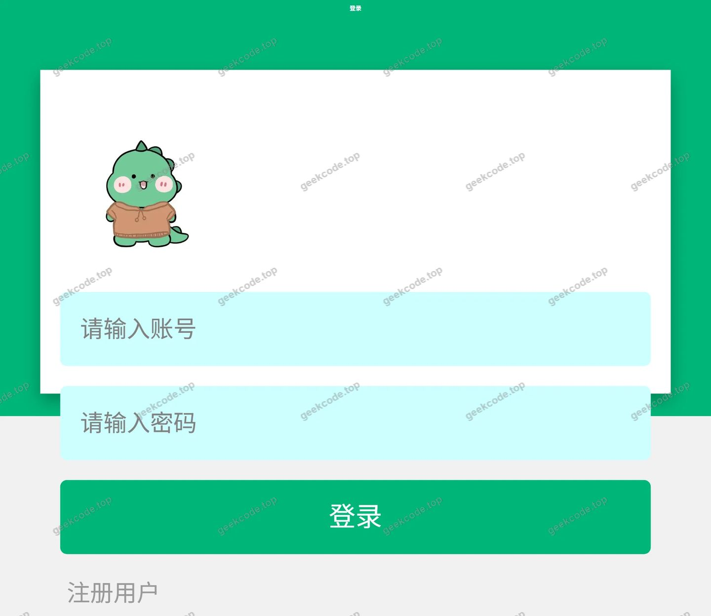</a>

<h3>微信小程序用户端</h3>

<figure><figcaption>小程序-登录</figcaption></figure>
<figure><figcaption>小程序-个人信息</figcaption></figure>
<figure><figcaption>小程序-确认订单</figcaption></figure>
<figure><figcaption>小程序-收货地址</figcaption></figure>
<figure><figcaption>小程序-首页</figcaption></figure>
<figure><a href="https://geekcode.top/archives/%E5%9F%BA%E4%BA%8E%E5%BE%AE%E4%BF%A1%E5%B0%8F%E7%A8%8B%E5%BA%8F%E7%9A%84%E4%BB%98%E8%B4%B9%E8%87%AA%E4%B9%A0%E5%AE%A4%E7%AE%A1%E7%90%86%E7%B3%BB%E7%BB%9F?utm_source=github" title="查看完整源码">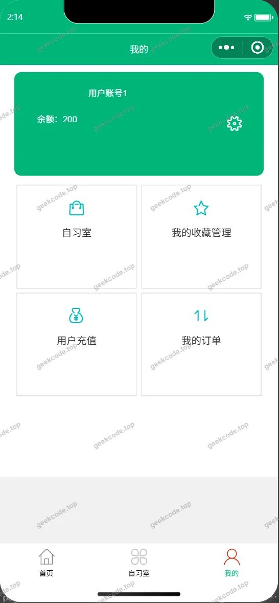</a><figcaption>小程序-我的</figcaption></figure>
<figure><figcaption>小程序-我的订单</figcaption></figure>
<figure><figcaption>小程序-我的收藏列表</figcaption></figure>
<figure><a href="https://geekcode.top/archives/%E5%9F%BA%E4%BA%8E%E5%BE%AE%E4%BF%A1%E5%B0%8F%E7%A8%8B%E5%BA%8F%E7%9A%84%E4%BB%98%E8%B4%B9%E8%87%AA%E4%B9%A0%E5%AE%A4%E7%AE%A1%E7%90%86%E7%B3%BB%E7%BB%9F?utm_source=github" title="查看完整源码">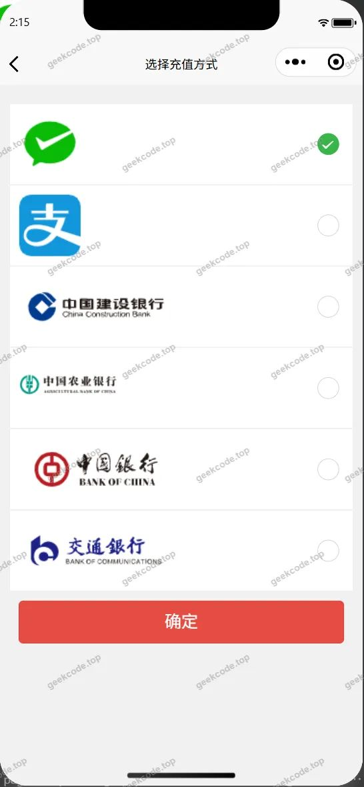</a><figcaption>小程序-账户充值payconfirm</figcaption></figure>
<figure><a href="https://geekcode.top/archives/%E5%9F%BA%E4%BA%8E%E5%BE%AE%E4%BF%A1%E5%B0%8F%E7%A8%8B%E5%BA%8F%E7%9A%84%E4%BB%98%E8%B4%B9%E8%87%AA%E4%B9%A0%E5%AE%A4%E7%AE%A1%E7%90%86%E7%B3%BB%E7%BB%9F?utm_source=github" title="查看完整源码">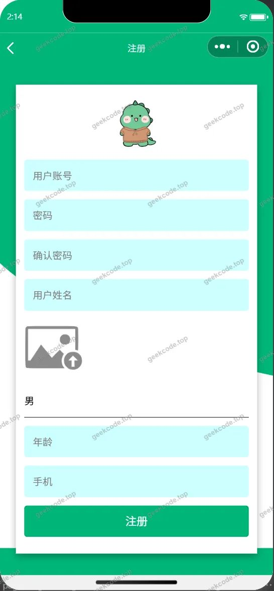</a><figcaption>小程序-注册</figcaption></figure>
<figure><a href="https://geekcode.top/archives/%E5%9F%BA%E4%BA%8E%E5%BE%AE%E4%BF%A1%E5%B0%8F%E7%A8%8B%E5%BA%8F%E7%9A%84%E4%BB%98%E8%B4%B9%E8%87%AA%E4%B9%A0%E5%AE%A4%E7%AE%A1%E7%90%86%E7%B3%BB%E7%BB%9F?utm_source=github" title="查看完整源码">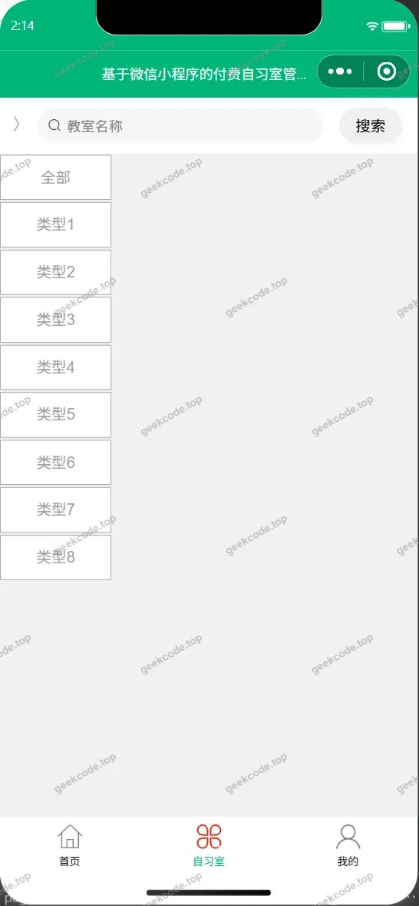</a><figcaption>小程序-自习室</figcaption></figure>

<h3>微信小程序管理端</h3>

<figure><figcaption>小程序-管理端-公告信息列表</figcaption></figure>
<figure><figcaption>小程序-管理端-购物车</figcaption></figure>
<figure><a href="https://geekcode.top/archives/%E5%9F%BA%E4%BA%8E%E5%BE%AE%E4%BF%A1%E5%B0%8F%E7%A8%8B%E5%BA%8F%E7%9A%84%E4%BB%98%E8%B4%B9%E8%87%AA%E4%B9%A0%E5%AE%A4%E7%AE%A1%E7%90%86%E7%B3%BB%E7%BB%9F?utm_source=github" title="查看完整源码">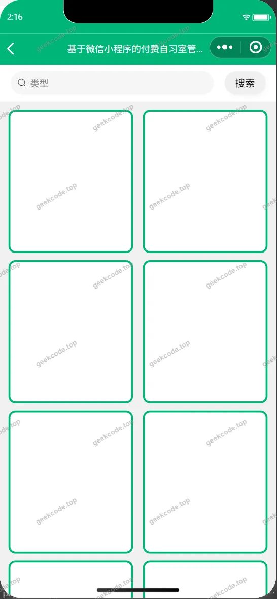</a><figcaption>小程序-管理端-类型列表</figcaption></figure>
<figure><a href="https://geekcode.top/archives/%E5%9F%BA%E4%BA%8E%E5%BE%AE%E4%BF%A1%E5%B0%8F%E7%A8%8B%E5%BA%8F%E7%9A%84%E4%BB%98%E8%B4%B9%E8%87%AA%E4%B9%A0%E5%AE%A4%E7%AE%A1%E7%90%86%E7%B3%BB%E7%BB%9F?utm_source=github" title="查看完整源码">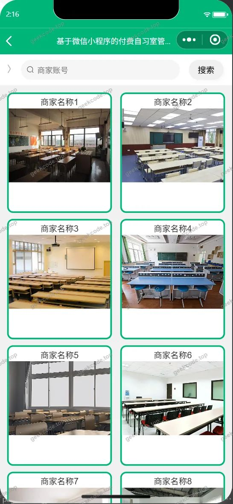</a><figcaption>小程序-管理端-商家列表</figcaption></figure>
<figure><a href="https://geekcode.top/archives/%E5%9F%BA%E4%BA%8E%E5%BE%AE%E4%BF%A1%E5%B0%8F%E7%A8%8B%E5%BA%8F%E7%9A%84%E4%BB%98%E8%B4%B9%E8%87%AA%E4%B9%A0%E5%AE%A4%E7%AE%A1%E7%90%86%E7%B3%BB%E7%BB%9F?utm_source=github" title="查看完整源码">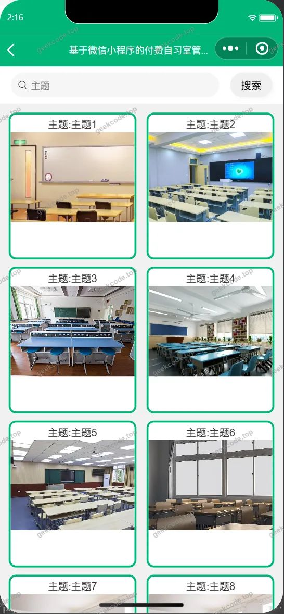</a><figcaption>小程序-管理端-新闻资讯列表</figcaption></figure>
<figure><figcaption>小程序-管理端-用户列表</figcaption></figure>

<h3>后台管理端</h3>
<h4>后台-登录页</h4>

<h4>后台-公告信息</h4>

<a href="https://geekcode.top/archives/%E5%9F%BA%E4%BA%8E%E5%BE%AE%E4%BF%A1%E5%B0%8F%E7%A8%8B%E5%BA%8F%E7%9A%84%E4%BB%98%E8%B4%B9%E8%87%AA%E4%B9%A0%E5%AE%A4%E7%AE%A1%E7%90%86%E7%B3%BB%E7%BB%9F?utm_source=github" title="查看完整源码">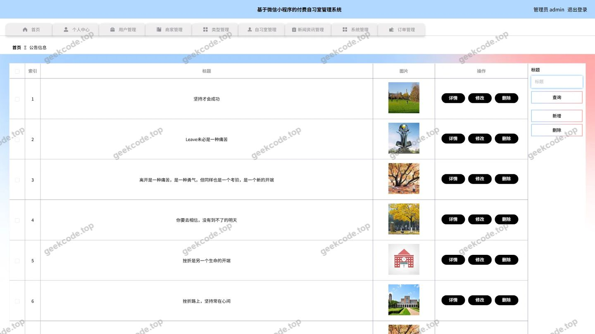</a>

<h4>后台-类型</h4>

<a href="https://geekcode.top/archives/%E5%9F%BA%E4%BA%8E%E5%BE%AE%E4%BF%A1%E5%B0%8F%E7%A8%8B%E5%BA%8F%E7%9A%84%E4%BB%98%E8%B4%B9%E8%87%AA%E4%B9%A0%E5%AE%A4%E7%AE%A1%E7%90%86%E7%B3%BB%E7%BB%9F?utm_source=github" title="查看完整源码">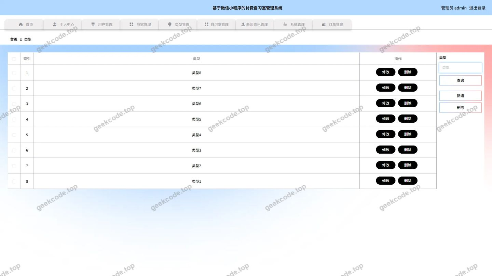</a>

<h4>后台首页</h4>

<a href="https://geekcode.top/archives/%E5%9F%BA%E4%BA%8E%E5%BE%AE%E4%BF%A1%E5%B0%8F%E7%A8%8B%E5%BA%8F%E7%9A%84%E4%BB%98%E8%B4%B9%E8%87%AA%E4%B9%A0%E5%AE%A4%E7%AE%A1%E7%90%86%E7%B3%BB%E7%BB%9F?utm_source=github" title="查看完整源码">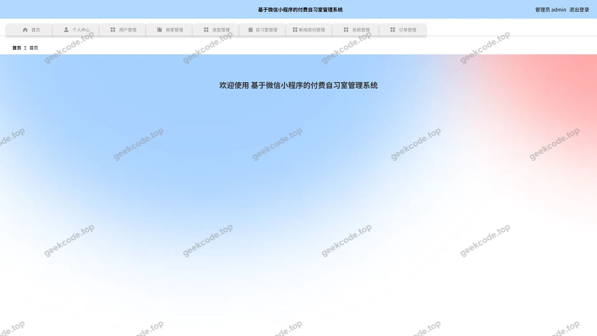</a>

<h4>后台-新闻资讯</h4>

<a href="https://geekcode.top/archives/%E5%9F%BA%E4%BA%8E%E5%BE%AE%E4%BF%A1%E5%B0%8F%E7%A8%8B%E5%BA%8F%E7%9A%84%E4%BB%98%E8%B4%B9%E8%87%AA%E4%B9%A0%E5%AE%A4%E7%AE%A1%E7%90%86%E7%B3%BB%E7%BB%9F?utm_source=github" title="查看完整源码">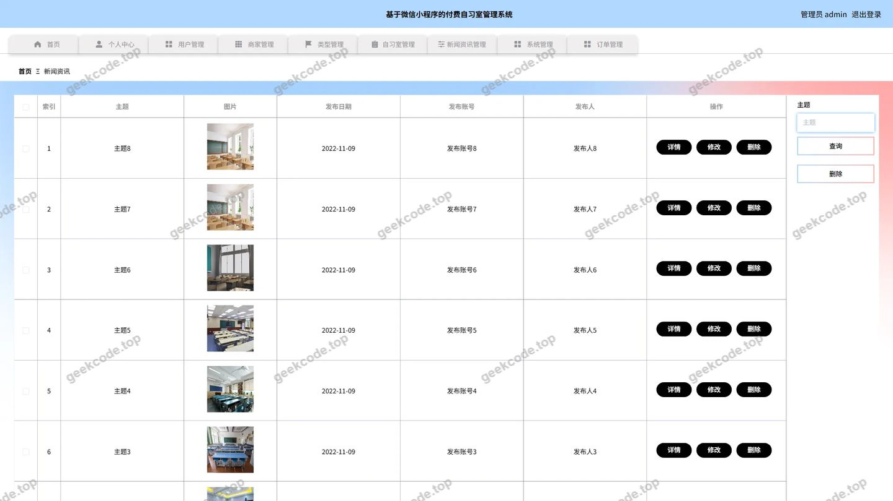</a>

<h4>后台-用户</h4>

<a href="https://geekcode.top/archives/%E5%9F%BA%E4%BA%8E%E5%BE%AE%E4%BF%A1%E5%B0%8F%E7%A8%8B%E5%BA%8F%E7%9A%84%E4%BB%98%E8%B4%B9%E8%87%AA%E4%B9%A0%E5%AE%A4%E7%AE%A1%E7%90%86%E7%B3%BB%E7%BB%9F?utm_source=github" title="查看完整源码">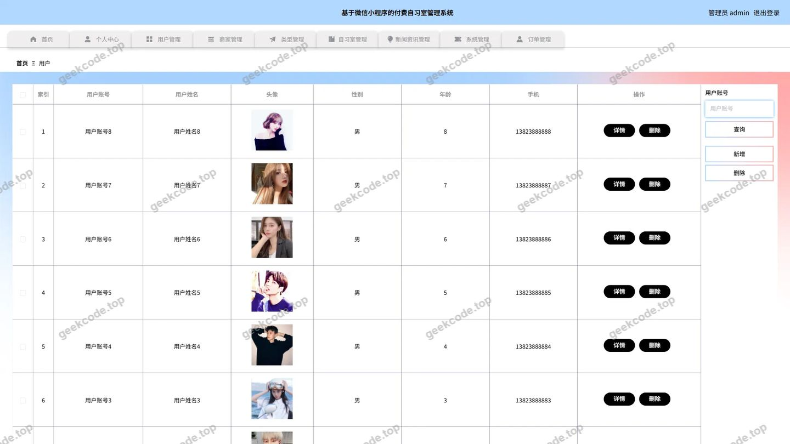</a>

<h4>后台-自习室</h4>

<a href="https://geekcode.top/archives/%E5%9F%BA%E4%BA%8E%E5%BE%AE%E4%BF%A1%E5%B0%8F%E7%A8%8B%E5%BA%8F%E7%9A%84%E4%BB%98%E8%B4%B9%E8%87%AA%E4%B9%A0%E5%AE%A4%E7%AE%A1%E7%90%86%E7%B3%BB%E7%BB%9F?utm_source=github" title="查看完整源码">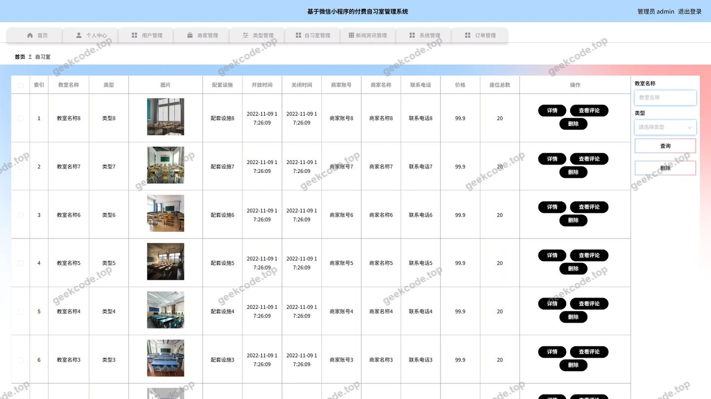</a>

<h4>后台-自习室评论</h4>

<a href="https://geekcode.top/archives/%E5%9F%BA%E4%BA%8E%E5%BE%AE%E4%BF%A1%E5%B0%8F%E7%A8%8B%E5%BA%8F%E7%9A%84%E4%BB%98%E8%B4%B9%E8%87%AA%E4%B9%A0%E5%AE%A4%E7%AE%A1%E7%90%86%E7%B3%BB%E7%BB%9F?utm_source=github" title="查看完整源码">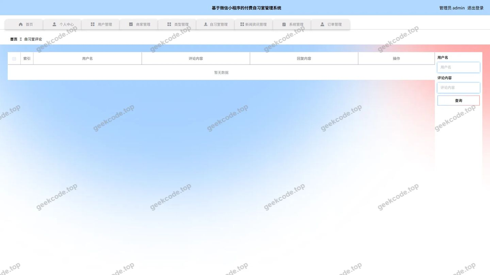</a>

---

## 获取完整源码

| 项目 | 说明 |
| --- | --- |
| 项目名 | 基于微信小程序的付费自习室管理系统 |
| 运行截图 | 本文 26 张（站点带水印原图，仓库 `images/` 目录） |
| 完整源码 | [https://geekcode.top/archives/%E5%9F%BA%E4%BA%8E%E5%BE%AE%E4%BF%A1%E5%B0%8F%E7%A8%8B%E5%BA%8F%E7%9A%84%E4%BB%98%E8%B4%B9%E8%87%AA%E4%B9%A0%E5%AE%A4%E7%AE%A1%E7%90%86%E7%B3%BB%E7%BB%9F?utm_source=github](https://geekcode.top/archives/%E5%9F%BA%E4%BA%8E%E5%BE%AE%E4%BF%A1%E5%B0%8F%E7%A8%8B%E5%BA%8F%E7%9A%84%E4%BB%98%E8%B4%B9%E8%87%AA%E4%B9%A0%E5%AE%A4%E7%AE%A1%E7%90%86%E7%B3%BB%E7%BB%9F?utm_source=github) |
| 咨询微信 | **ir9372**（备注：jingpin-yuanma） |
| 更多项目 | [极客代码 geekcode.top](https://geekcode.top/?utm_source=github) |

> 需要源码、部署、改配置、跑不起来等问题，加微信 ir9372 沟通，说明项目名即可。
